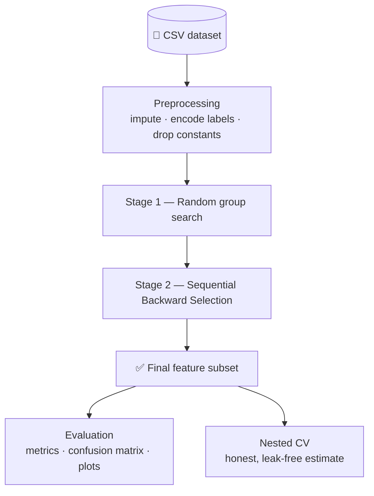
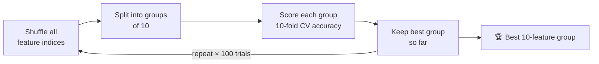
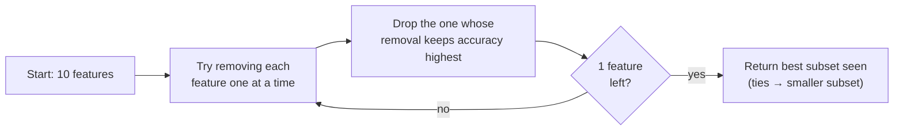
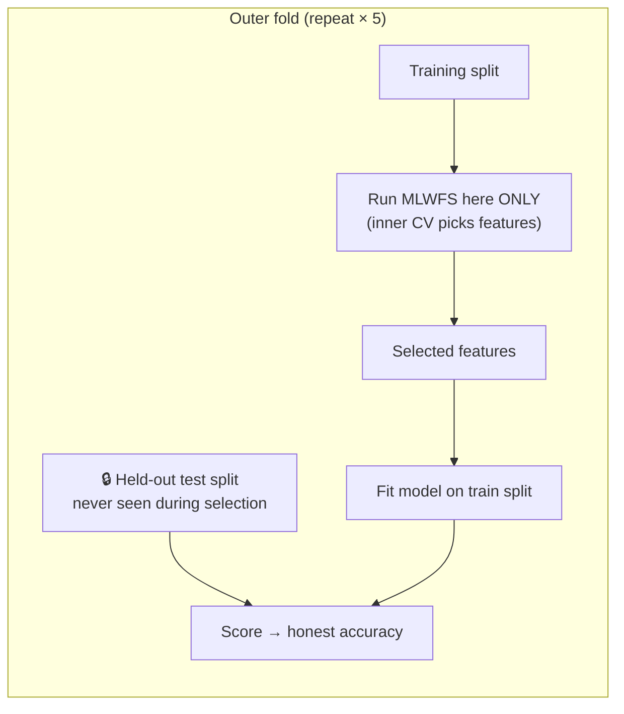
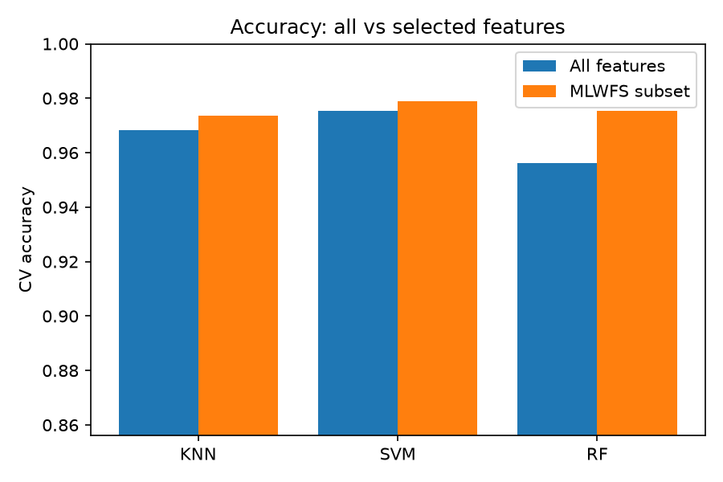
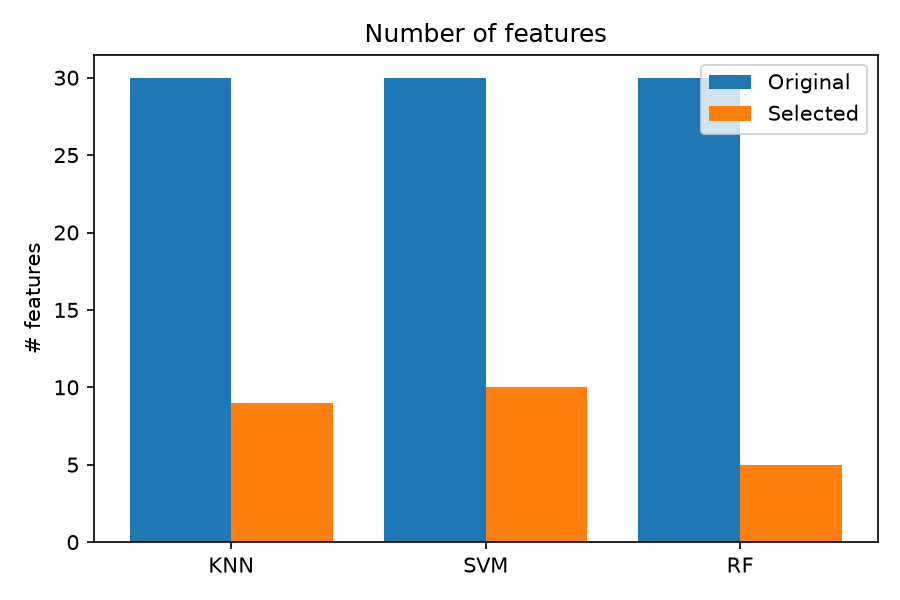
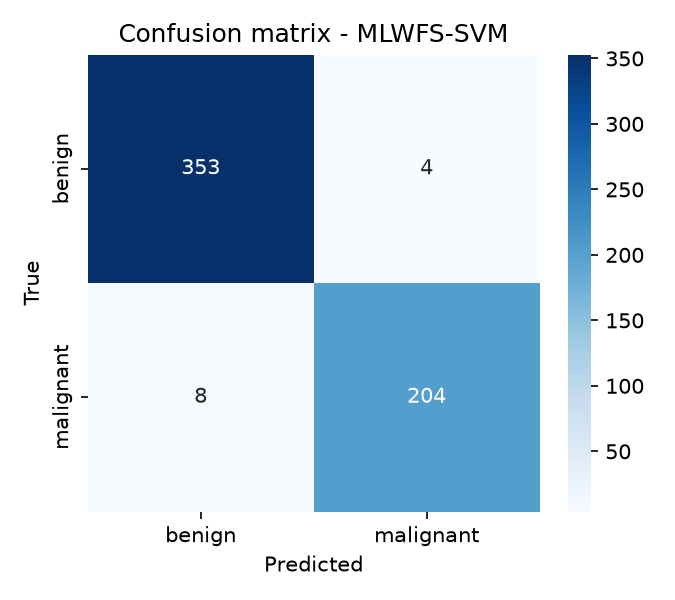
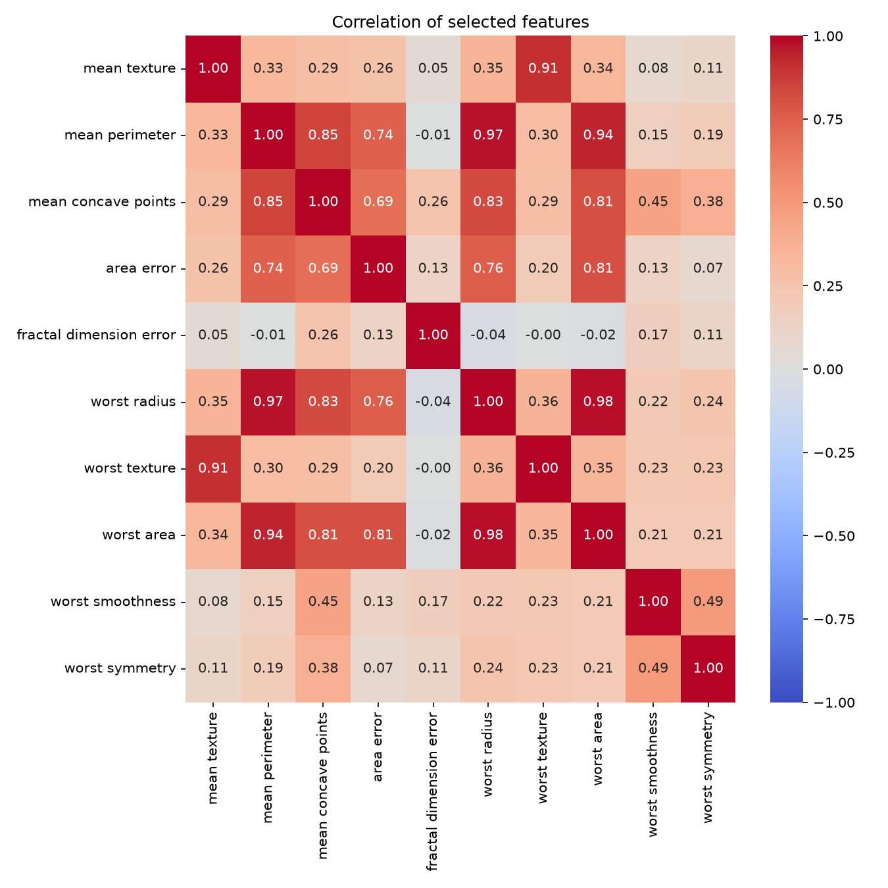

<div align="center">

# 🔬 MLWFS — Machine-Learning Wrapper Feature Selection

**Shrink 30 features down to ~5–10 without losing accuracy.**
A two-stage wrapper feature-selection pipeline (random group search → Sequential Backward Selection) with KNN, SVM and Random Forest, leak-free nested cross-validation, and a Streamlit app.

   

</div>

---

## 📖 What is this?

A dataset can have dozens or thousands of columns (*features*), and many are redundant or noisy.
**Feature selection** finds the smallest subset that still predicts well, which gives faster models,
less overfitting and results that are easier to interpret.

MLWFS is a **wrapper** method: it judges a feature subset by actually training a **classifier** on it
(here KNN, SVM or Random Forest) and measuring cross-validated accuracy.

## ⚙️ How it works



### Stage 1 — random feature-group search



Trying every feature combination is impossible (2³⁰ ≈ 1 billion subsets for just 30 features), so random
shuffling gives a cheap way to land on a strong starting group.

### Stage 2 — Sequential Backward Selection (SBS)



Example path: `10 → 9 → 8 → … → 1` features, recording accuracy at every step and keeping the best one.

### Avoiding data leakage



Plain MLWFS scores are **optimistic**: the same CV that picks the features also reports the accuracy.
Nested CV fixes this, and it is what you should quote in a report.

## 🧠 The classifiers

| | **KNN** (k=3) | **SVM** (rbf) | **Random Forest** |
|---|---|---|---|
| Idea | Majority vote of the 3 nearest examples | Widest-margin curved boundary | 100 decision trees vote |
| Needs scaling | ✅ | ✅ | ❌ |
| Speed here | ⚡ fast | ⚡ fast | 🐢 slower |

A `StandardScaler` sits inside every model pipeline, so it is fit on training folds only.

## 🚀 Quick start

```bash
git clone https://github.com/mohan223311/mlwfs-feature-selection.git
cd mlwfs-feature-selection
python3 -m venv .venv && source .venv/bin/activate
pip install -r requirements.txt
```

**Web app**
```bash
streamlit run app.py
```
Upload a CSV (or use the built-in Breast Cancer demo), pick the target column and classifier(s), set group
size and trials, then click **Run MLWFS**. Results, plots and nested CV are shown in tabs, and you can
download the results as CSV.

App extras: runtime estimate before you run, friendly errors for bad targets / tiny classes, a feature-overlap
table across classifiers, PNG download for every plot, and an **About** tab that explains the method.

**Command line**
```bash
python main.py --classifiers KNN SVM RF --trials 100 --nested
python main.py --csv data/yourfile.csv --target label --classifiers KNN
```

| Flag | Default | Meaning |
|---|---|---|
| `--group-size` | 10 | Features per group in Stage 1 |
| `--trials` | 100 | Random shuffles in Stage 1 |
| `--cv-folds` | 10 | Stratified CV folds |
| `--nested` | off | Also run nested CV |
| `--seed` | 42 | Reproducibility |

## 📊 Results (Breast Cancer, 569 samples × 30 features)

| Classifier | Features (all → selected) | CV accuracy (all) | CV accuracy (selected) | **Nested-CV accuracy** (all → selected) | MLWFS runtime |
|---|---|---|---|---|---|
| KNN | 30 → 9 | 0.968 | 0.974 | 0.967 → **0.949** | 6s |
| SVM | 30 → 10 | 0.975 | 0.979 | 0.977 → **0.968** | 7s |
| RF | 30 → 5 | 0.956 | 0.975 | 0.954 → **0.956** | 157s |

> Settings: group size 10, 100 trials, 10-fold stratified CV, seed 42 (nested CV: 5 outer folds, 20 trials).
> The plain CV columns are optimistic because the same folds pick the features. The **nested-CV** column is the
> honest estimate: roughly **30 → 7 features with a ~0–2 point accuracy change**.


<p align="center">
  
  <br>
  
  
</p>

## 🗂️ Project structure

```text
mlwfs-feature-selection/
├── app.py                 # Streamlit UI
├── main.py                # CLI runner
├── src/
│   ├── preprocessing.py   # load CSV, impute, encode, stats
│   ├── models.py          # KNN / SVM / RF pipelines
│   ├── evaluation.py      # evaluate_features(), confusion matrix
│   ├── mlwfs.py           # Stage 1, Stage 2 (SBS), nested CV
│   └── visualizations.py  # plots
├── tests/test_mlwfs.py    # pytest suite
├── data/                  # datasets
├── results/               # generated tables & charts
└── requirements.txt
```

## ✅ Testing

```bash
python -m pytest tests -s
```
The suite checks that MLWFS recovers the truly informative features on synthetic data, that it scores
near chance (~50%) on random labels (no leakage), that runs are reproducible, and that SBS tie-breaking
and preprocessing behave correctly.

## 📚 Reference

Based on *A Machine Learning-Based Wrapper Method for Feature Selection*.

## 📝 Notes & limitations
- Random Forest is much slower than KNN/SVM because every candidate subset trains 100 trees.
- Stage 1 is random, so results depend on the seed; more trials give a more stable result.
- Metrics (precision/recall/F1) are macro-averaged.
